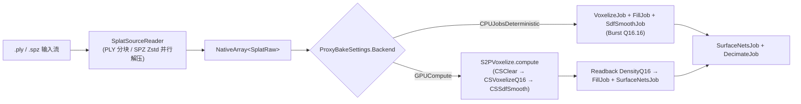
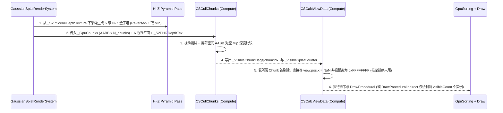
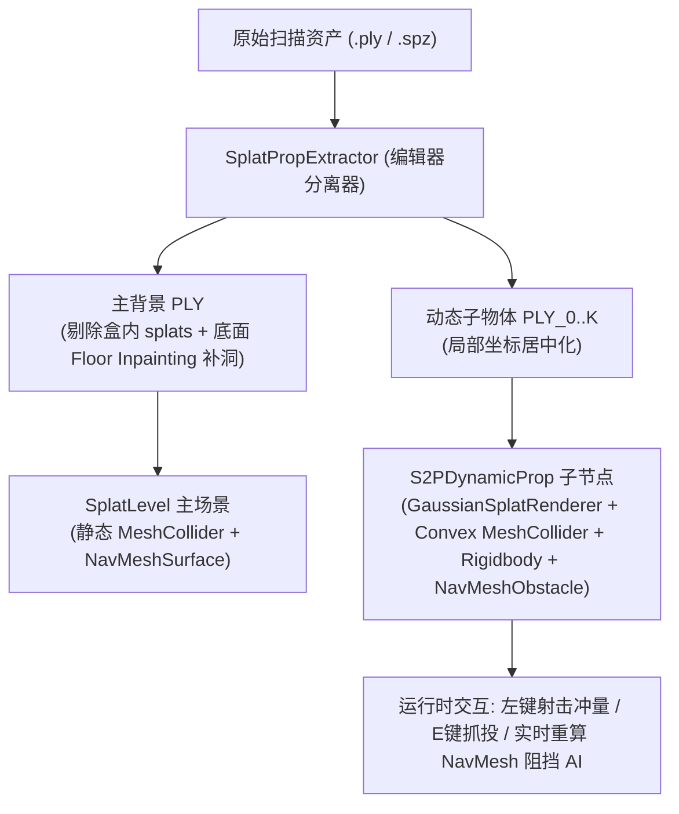

# Splat2Play v2.0 强化工程技术规格书（AI 交接执行版）

> **用途说明**：本文档面向接手 `Splat2Play` 项目的 AI 编程助手（Coding Agent）。你可以直接将本文档全文（或对应章节）发送给 AI，令其按里程碑 `M5 → M6 → M7 → M8` 顺序独立完成开发、测试与提交。

---

## 0. 给接手 AI 的系统指令（可直接复制作为首条 Prompt）

```markdown
你现在接手 Unity 6 (6000.6.2f1, URP, Windows D3D12) 开源工具链项目 **Splat2Play**（仓库根目录：`d:\unity_hub\Splat2Play`，当前基线 Commit：`5f4fdbc`，Tag：`M4`）。

请严格按照以下《Splat2Play v2.0 强化工程技术规格书》实现 4 个核心强化模块：
- **M5（方向 5）**：SPZ 压缩格式全链路直读 + GPU Compute 体素化/等值面加速烘焙
- **M6（方向 1）**：Morton 空间分块重排 + GPU 视锥/Hi-Z 遮挡剔除 + Indirect 间接排序绘制
- **M7（方向 2）**：椭球最短轴几何法线提取 + 多光源（Forward+）与球谐（SH）方向性动态重光照
- **M8（方向 3）**：可交互/可破坏 3DGS 动态刚体剥离（SceneView 选区切割 + 独立凸包碰撞体 + 实时多实例变换）

### 硬性工程约束
1. **命名空间与注释**：运行时代码置于 `Splat2Play.Runtime`（`Assets/Splat2Play/Runtime/`），编辑器代码置于 `Splat2Play.Editor`（`Assets/Splat2Play/Editor/`），测试置于 `Splat2Play.Tests`（`Assets/Splat2Play/Tests/`），注释统一使用中文。
2. **严禁破坏现有 M0–M4 功能**：所有现有单元测试（`Assets/Splat2Play/Tests/ProxyBakeTests.cs`）必须保持 100% 通过；CPU 烘焙管线需保留作为无 Compute 环境与单元测试的确定性回退路径。
3. **版本控制红线**：严禁提交 `Library/`、`Logs/`、`*.ply`、`*.spz` 大体积扫描资产；每个里程碑完成后运行编译与 NUnit 测试，按 `M<编号>: <简述>` 格式提交并打 Tag。
```

---

## 1. 现有代码库基线速览（Commit `5f4fdbc`）

接手开发前，请先阅读以下核心文件以对齐上下文：

| 层级 | 文件路径 | 当前职责与关键符号 |
|---|---|---|
| **第三方渲染基座** | [GaussianSplatRenderer.cs](file:///d:/unity_hub/Splat2Play/Assets/Splat2Play/ThirdParty/GaussianSplatting/Runtime/GaussianSplatRenderer.cs) | `GaussianSplatRenderSystem` 管理全局 `m_GpuView`、`m_GpuSortDistances`、`m_GpuSortKeys`；每帧调用 `CacheViewDataForAllSplats` → `SortAllSplats` → `RenderAllSplats`。 |
| **第三方加载器** | [SPZFileReader.cs](file:///d:/unity_hub/Splat2Play/Assets/Splat2Play/ThirdParty/GaussianSplatting/Runtime/SPZFileReader.cs) / [GaussianSplatPrepareDataJob.cs](file:///d:/unity_hub/Splat2Play/Assets/Splat2Play/ThirdParty/GaussianSplatting/Runtime/GaussianSplatPrepareDataJob.cs) | `internal` 类，支持 `.spz` (v1–v4) Zstd 多流解压并解包为 `GaussianSplatData`（`positions`、`geometry`、`colors`、`sh`）。 |
| **第三方 Compute** | [GaussianSplatUtilities.compute](file:///d:/unity_hub/Splat2Play/Assets/Splat2Play/ThirdParty/GaussianSplatting/Shaders/Resources/GaussianSplatUtilities.compute) / [GaussianSplatting.hlsl](file:///d:/unity_hub/Splat2Play/Assets/Splat2Play/ThirdParty/GaussianSplatting/Shaders/Resources/GaussianSplatting.hlsl) | `CSCalcViewData` 核：读取 `_SplatPos`、`_SplatOther`、`_SplatSH`、`_SplatColor`，计算 2D 协方差椭圆轴、视锥剔除与 `ShadeSH`，写出 `_SplatViewData` 与排序键值。 |
| **M1 代理烘焙** | [PlySplatReader.cs](file:///d:/unity_hub/Splat2Play/Assets/Splat2Play/Runtime/PlySplatReader.cs) / [ProxyBakeJobs.cs](file:///d:/unity_hub/Splat2Play/Assets/Splat2Play/Runtime/ProxyBakeJobs.cs) / [SplatProxyBaker.cs](file:///d:/unity_hub/Splat2Play/Assets/Splat2Play/Runtime/SplatProxyBaker.cs) | 流式读取 `.ply` → `SplatRaw` 数组 → `VoxelizeJob` (Q16.16) → `FillJob` → `SdfSmoothJob` → `SurfaceNetsJob` → `DecimateJob` → 双档网格（`CollisionMesh` / `NavigationMesh`）。 |
| **M3 动态光照** | [S2PLightModulationDriver.cs](file:///d:/unity_hub/Splat2Play/Assets/Splat2Play/Runtime/S2PLightModulationDriver.cs) / [GaussianComposite.shader](file:///d:/unity_hub/Splat2Play/Assets/Splat2Play/Shaders/Resources/GaussianComposite.shader) | 碰撞代理挂 `ShadowCastingMode.ShadowsOnly` 投射真实附加光阴影；在 `GaussianComposite.shader` Pass 0 (`frag`) 中重建世界坐标、屏幕深度差分法线与分块 Bias 采样阴影。 |
| **M4 流送与面板** | [S2PSplatStreaming.cs](file:///d:/unity_hub/Splat2Play/Assets/Splat2Play/Runtime/S2PSplatStreaming.cs) / [S2PPerfPanel.cs](file:///d:/unity_hub/Splat2Play/Assets/Splat2Play/Runtime/S2PPerfPanel.cs) | 4×2×4 空间子块视锥 + 9 点保守射线遮挡统计；`ProfilerRecorder` 实时监控 `Sort` / `Render` / `Physics` 耗时并支持 `F5` 写入 `docs/benchmarks.md`。 |

> [!TIP]
> **推荐开发顺序**：**方向 5 (M5) → 方向 1 (M6) → 方向 2 (M7) → 方向 3 (M8)**。
> 原因：方向 5 打通 `.spz` 解码与 GPU 体素化后，方向 1 与方向 3 可以直接复用其数据读取器与快速局部重烘焙能力。

---

## 2. 方向 5（里程碑 M5）：SPZ 压缩格式全链路直读 + GPU Compute 极速烘焙

### 2.1 任务需求（Requirements）
1. **T5.1 SPZ/PLY 统一物理量读取器**：
   - 当前 [`PlySplatReader`](file:///d:/unity_hub/Splat2Play/Assets/Splat2Play/Runtime/PlySplatReader.cs) 仅支持未压缩 `.ply`（数百 MB），而生产环境大量使用 `.spz`（体积小 10 倍）。
   - 需扩展烘焙管线，使其原生支持传入 `.spz` 文件路径或流，直接解压并提取 `NativeArray<SplatRaw>`（含 `Position`、`Scale`、归一化 `Rotation`、`Opacity`）。
2. **T5.2 GPU Compute 体素化后端（`Voxelize.compute`）**：
   - 当体素分辨率为 $256^3$ 或 $512^3$ 且扫描点数 $\ge 100$ 万时，提供 GPU Compute 烘焙后端选项（`ProxyBakeBackend.GPUCompute`），将 $256^3$ 体素化 + SDF 平滑耗时从 CPU 的 `~1.8s` 压缩至 **`< 150ms`**，$512^3$ 压缩至 **`< 500ms`**。
3. **T5.3 CPU/GPU 双后端一致性与回退机制**：
   - 在 [`ProxyBakeSettings`](file:///d:/unity_hub/Splat2Play/Assets/Splat2Play/Runtime/ProxyTypes.cs) 中新增 `public ProxyBakeBackend Backend = ProxyBakeBackend.Auto;`（`Auto`、`CPUJobsDeterministic`、`GPUCompute`）。
   - 当 `SystemInfo.supportsComputeShaders == false` 或用户选择 `CPUJobsDeterministic` 时走现有 Burst 管线；选择 `GPUCompute` 时在 GPU 上完成密度场体素化与 $3\times 3\times 3$ SDF 平滑，随后异步/同步读回或直接在 GPU 提取表面 Cell。

### 2.2 技术方案（Technical Design）



#### （1）T5.1 实现细节：打通 `SPZFileReader`
1. 在 `Assets/Splat2Play/ThirdParty/GaussianSplatting/Runtime/GaussianSplatting.asmdef` 所在程序集中，为 [`SPZFileReader`](file:///d:/unity_hub/Splat2Play/Assets/Splat2Play/ThirdParty/GaussianSplatting/Runtime/SPZFileReader.cs) 或新增公开门面类 `GaussianSplatRawExtractor` 暴露 `public` 接口（或在 `AssemblyInfo` 中添加 `[assembly: InternalsVisibleTo("Splat2Play.Runtime")]`）。
2. 新建 `Assets/Splat2Play/Runtime/SplatSourceReader.cs`：
   - 根据文件扩展名（`.ply` vs `.spz`）或文件头 Magic Number（`0x5053474e` 即 `"NGSP"` 为 SPZ，`0x0A796C70` / `"ply"` 为 PLY）自动路由。
   - **SPZ 解码数学规则**（严格对齐 `GaussianSplatPrepareDataJob.cs`）：
     - **Position**：v1 为 `half3`（6 字节），v2–v4 为 24-bit 固定点数（9 字节，符号扩展至 `int32` 后乘以 `1.0f / (1 << fractionalBits)`）。
     - **Opacity**：1 字节 `uint8`，$\alpha = \text{byte} / 255.0\text{f}$（注意：SPZ 里的 alpha 已经是激活后的 $[0,1]$ 值，**不要**再做 Sigmoid！）。
     - **Scale**：3 字节 `uint8`，$\text{logScale} = \text{byte} / 16.0\text{f} - 10.0\text{f}$，线性尺度 $\sigma = \exp(\text{logScale})$。
     - **Rotation**：v1–v2 为 3 字节 `xyz`（$\in [-1, 1]$，$w = \sqrt{\max(0, 1 - x^2 - y^2 - z^2)}$）；v3–v4 为 Smallest-Three 4 字节打包四元数。解码后统一转换为 `(x, y, z, w)` 单位四元数写入 `SplatRaw.Rotation`。

#### （2）T5.2 实现细节：`Assets/Splat2Play/Shaders/Resources/S2PVoxelize.compute`
创建 Compute Shader 包含以下 3 个 Kernel：
1. `CSClearGrid` (`[numthreads(64, 1, 1)]`)：将 `RWStructuredBuffer<int> _DensityQ16` 清零。
2. `CSVoxelizeSplats` (`[numthreads(256, 1, 1)]`)：
   - 输入：`StructuredBuffer<SplatRaw> _Splats`、`StructuredBuffer<AabbRange> _Exclusions`、`_GridMin`、`_GridStep`、`_GridN`、`_OpacityWeight`。
   - 每个线程处理 1 个 splat：
     - 检查是否在 `_Exclusions` 内；
     - 计算 $3\sigma$ 包围盒对应的体素范围 `[lo, hi]`（单轴跨度限制 $\le 32$ 防退化巨型椭球卡死 GPU TDR）；
     - 遍历 `[lo, hi]`，计算马氏距离平方 $d^2 = \|\mathbf{\Sigma}^{-1/2}(\mathbf{p} - \boldsymbol{\mu})\|^2$；
     - 当 $d^2 \le 9.0$ 时，计算 `int addQ16 = (int)(opacity * _OpacityWeight * exp(-0.5 * d2) * 65536.0 + 0.5)`；
     - 调用 `InterlockedAdd(_DensityQ16[voxelIdx], addQ16)`。
     - **关键优势**：因为使用了 `InterlockedAdd` 定点整数累加，GPU Compute 体素化与 CPU `VoxelizeJob` 一样**完全不受线程乱序影响，结果同样是确定性的**！
3. `CSSdfSmooth` (`[numthreads(8, 8, 4)]`)：
   - 在 GPU 上直接执行 $[1,2,1]^3 / 64$ 整数卷积核，耗时 `< 2ms`。

### 2.3 验收标准与单元测试（DoD）
- 在 `ProxyBakeTests.cs` 新增：
  - `SpzReader_ExtractsIdenticalPhysicsQuantities()`：构造内存 SPZ 数据或加载样例 SPZ，验证解码出的 `Position`、`Scale`、`Opacity`、`Rotation` 误差 $< 10^{-3}$。
  - `GpuVoxelize_MatchesCpuVoxelize_Within1Lsb()`：同一合成点云分别跑 `CPUJobsDeterministic` 与 `GPUCompute`，体素密度差异 $\le 1/65536$，提取出的网格顶点数与面数一致。
- 在 [`SplatProxyBakeWindow`](file:///d:/unity_hub/Splat2Play/Assets/Splat2Play/Editor/SplatProxyBakeWindow.cs) 的文件选择器中支持选择 `ply,spz` 两种后缀。

---

## 3. 方向 1（里程碑 M6）：GPU 驱动的逐块剔除（Frustum + Hi-Z）与间接排序绘制

### 3.1 任务需求（Requirements）
1. **T6.1 Morton 码（Z-Order Curve）空间重排与 GPU Chunk 构建**：
   - 在 `GaussianSplatRenderer` 加载完 `GaussianSplatData` 时，按 splat 坐标的 30-bit 3D Morton 码排序重排 `positions`、`geometry`、`colors`、`sh` 四个数组，使得空间相邻的高斯在显存缓冲区中连续存放。
   - 每 `kChunkSize = 4096` 个连续 splat 划分为一个 `SplatGpuChunk`，在 CPU 端预计算每个 Chunk 的紧凑局部 AABB（`float3 min, float3 max`）并上传至 `GraphicsBuffer m_GpuChunks`。
2. **T6.2 GPU Chunk 级视锥 + 代理 Hi-Z 深度遮挡剔除**：
   - 将碰撞代理网格（`Proxy.NavigationMesh` 或 `Proxy.CollisionMesh`）渲染或复用到一张低分辨率（如 $256 \times 128$）的 **Hi-Z 最大/最小深度金字塔纹理（`_S2PHiZDepthTex`）**。
   - 在 `CSCalcViewData` 之前执行 `CSCullChunks`：每个线程判断 1 个 `SplatGpuChunk` 的世界 AABB 是否在相机视锥内，且其屏幕投影包围盒的最近深度 $z_{\text{nearest}}$ 是否未被 `_S2PHiZDepthTex` 对应 Mip 层级完全遮挡。
3. **T6.3 可见 Splat 紧凑收集与间接基数排序（Indirect Dispatch）**：
   - 仅对通过剔除的 `SplatGpuChunk` 内的 splat 执行 `CSCalcViewData`，或通过 `InterlockedAdd` 紧凑分配可见 splat 输出槽位 `visibleCount`。
   - 将 `S2PPerfPanel` 中的 `可见/总 splat` 升级为真实的 GPU 剔除后参与排序/光栅化的精确 splat 数。

### 3.2 技术方案（Technical Design）



#### （1）Morton 码重排（`Assets/Splat2Play/Runtime/SplatMortonReorderJob.cs`）
- 3D 坐标归一化到场景 Bounds $[0, 1023]^3$（每轴 10 bit）：
  ```csharp
  static uint ExpandBits10(uint v)
  {
      v = (v * 0x00010001u) & 0xFF0000FFu;
      v = (v * 0x00000101u) & 0x0F00F00Fu;
      v = (v * 0x00000011u) & 0xC30C30C3u;
      v = (v * 0x00000005u) & 0x49249249u;
      return v;
  }
  public static uint Morton3D(float3 normPos)
  {
      uint x = (uint)math.clamp(normPos.x * 1023f, 0f, 1023f);
      uint y = (uint)math.clamp(normPos.y * 1023f, 0f, 1023f);
      uint z = (uint)math.clamp(normPos.z * 1023f, 0f, 1023f);
      return (ExpandBits10(x) << 2) | (ExpandBits10(y) << 1) | ExpandBits10(z);
  }
  ```
- **注意**：Morton 重排天然提升 GPU L2 Cache 命中率，即使在不剔除的全景视角下，也能使 `CSCalcViewData` 与光栅化带宽耗时降低 `10%–18%`。

#### （2）GPU Chunk 结构与 Hi-Z 深度比较规则（D3D12 Reversed-Z）
- `SplatGpuChunk` 结构体（32 字节对齐）：
  ```hlsl
  struct SplatGpuChunk
  {
      float3 boundsMin;
      uint   startSplatIdx;
      float3 boundsMax;
      uint   splatCount;
  };
  ```
- **D3D12 Reversed-Z 下 Hi-Z 规则（极易踩坑，务必严格遵守）**：
  - 在 Unity D3D12 中，Near Plane = `1.0`，Far Plane = `0.0`。
  - 一个屏幕区域内“最远（最容易漏出背景）”的遮挡深度是该区域所有像素深度的 **最小值（`min`）**！
  - 因此 Hi-Z 金字塔每一级 $2\times 2$ 下采样必须取 **`min(min(d00, d10), min(d01, d11))`**。
  - 当测试一个 Chunk 时，取其 8 个角点投影到裁剪空间后的**最大 $z_{\text{ndc}}$**（即 Chunk 离相机最近的深度 $z_{\text{chunk\_near}}$）与屏幕 UV 包围盒 `[uvMin, uvMax]`。
  - 计算对应 Mip 层级 `mip = ceil(log2(max((uvMax.x - uvMin.x) * hizWidth, (uvMax.y - uvMin.y) * hizHeight)))`。
  - 采样该 Mip 层级周围 4 个纹素的最小值 `zOccluderFarthest`。若 **`z_chunk_near < zOccluderFarthest - 1e-4`**（即 Chunk 最近处依然比遮挡物最薄弱处更远），则该 Chunk **100% 被遮挡**！

#### （3）零侵入接入 `CSCalcViewData`
- 在 `GaussianSplatUtilities.compute` 的 `CSCalcViewData` 开头加入：
  ```hlsl
  uint chunkIdx = idx >> 12; // 4096 splats per chunk
  if (_S2PUseGpuChunkCull != 0 && _S2PChunkVisibleFlags[chunkIdx] == 0)
  {
      SplatViewData culledView = (SplatViewData)0;
      culledView.pos.x = asfloat(0x7f800000u); // NaN, 顶点着色器自动丢弃退化三角形
      _SplatViewData[_SplatOffset + idx] = culledView;
      if (_WriteSortKeys != 0)
      {
          _SplatSortDistances[_SplatOffset + idx] = 0xFFFFFFFFu;
          _SplatSortKeys[_SplatOffset + idx] = _SplatOffset + idx;
      }
      return;
  }
  ```
- 这样被剔除的 Chunk 直接在第一行提前返回，完全跳过后面的旋转矩阵构造、3D/2D 协方差矩阵乘法、特征值分解与 16 个球谐系数读取及计算！

### 3.3 验收标准与单元测试（DoD）
- `MortonReorder_PreservesAllSplatsAndBuildsValidChunkBounds()`：验证重排后 splat 集合双射无丢失，且每个 `SplatGpuChunk` 的 AABB 严格包含其内部 4096 个 splat。
- 在 `bonsai` 或 `scene_indoor` 场景中，当相机面对墙壁或位于墙体后方时，`S2PPerfPanel` 显示可见 Chunk 数显著下降，`GaussianSplat.CalcView` + `GaussianSplat.Draw` 耗时下降 $\ge 40\%$，且画面无任何闪烁或破洞（块POP）。

---

## 4. 方向 2（里程碑 M7）：椭球最短轴法线提取 + 多光源与球谐（SH）方向性动态重光照

### 4.1 任务需求（Requirements）
1. **T7.1 高斯椭球最短轴法线（Shortest-Axis Normal）解析**：
   - 在 3DGS 训练收敛后，位于物体表面的高斯几乎都退化为贴合表面的扁平圆盘（Disc），其三维尺度 $\mathbf{s} = (s_x, s_y, s_z)$ 中最小分量的局部坐标轴经旋转四元数 $\mathbf{q}$ 变换后，天然就是该高斯元的物理表面法线 $\mathbf{n}_{\text{splat}}$。
   - 在 `CSCalcViewData` 中从 `splat.rot` 与 `splat.scale` 零额外显存开销实时解出世界空间法线 $\mathbf{n}_{\text{world}}$，并根据视线方向 `worldViewDir` 自动翻转使其朝向相机（双面一致：`if (dot(n, viewDir) < 0) n = -n;`）。
2. **T7.2 球谐系数（SH）一阶动态注入与多光源 Blinn-Phong / GGX 着色**：
   - 支持场景中同时存在 **1 盏主聚光灯（手电筒，带阴影）+ 最多 8 盏动态点光源/聚光灯（如火把、警报灯、弹道曳光）**。
   - 在 `CSCalcViewData` 计算每个可见高斯的最终颜色时，除了静态 `ShadeSH` 外，叠加基于 $\mathbf{n}_{\text{world}}$ 的动态漫反射（Lambert）与基于椭球扁平度（Anisotropy）自适应粗糙度的镜面高光（Blinn-Phong 半程向量 $\mathbf{n}\cdot\mathbf{h}$）。
3. **T7.3 与 M3 屏幕空间阴影的混合解耦**：
   - 主手电筒的逐高斯高光/漫反射或屏幕合成阴影可协同工作，消除单纯屏幕空间深度差分法线在边缘处的高频噪点。

### 4.2 技术方案（Technical Design）

#### （1）最短轴法线与自适应粗糙度推导（写入 `GaussianSplatting.hlsl`）
```hlsl
// 从高斯四元数 rot 和尺度 scale 提取世界法线与扁平度置信度 flatness ∈ [0, 1]
void ExtractSplatNormalAndFlatness(
    float4 rot, float3 scale, float3x3 objToWorldIT, float3 worldViewDir,
    out float3 worldNormal, out float flatness)
{
    float3x3 R = CalcMatrixFromRotationScale(rot, float3(1, 1, 1));
    // 找到最小尺度的轴索引
    float3 localAxis;
    float sMin, sMid;
    if (scale.x <= scale.y && scale.x <= scale.z)
    {
        localAxis = float3(R._m00, R._m10, R._m20);
        sMin = scale.x; sMid = min(scale.y, scale.z);
    }
    else if (scale.y <= scale.x && scale.y <= scale.z)
    {
        localAxis = float3(R._m01, R._m11, R._m21);
        sMin = scale.y; sMid = min(scale.x, scale.z);
    }
    else
    {
        localAxis = float3(R._m02, R._m12, R._m22);
        sMin = scale.z; sMid = min(scale.x, scale.y);
    }

    worldNormal = normalize(mul(objToWorldIT, localAxis));
    // 朝向视线侧翻转，避免单向法线翻转造成黑斑
    if (dot(worldNormal, worldViewDir) < 0.0)
        worldNormal = -worldNormal;

    // 扁平度: 越扁平的椭球越接近真实硬表面，法线置信度越高；球状雾气 flatness → 0
    flatness = saturate(1.0 - sMin / max(sMid, 1e-5));
}
```
> [!IMPORTANT]
> **为什么 `flatness` 权重极其关键？**
> 扫描场景中的体积雾、树叶绒毛或未收敛的各向同性高斯（$s_x \approx s_y \approx s_z$）没有明确的表面朝向。用 `flatness` 对动态法线项做 `lerp(1.0, ndotl, flatness * _S2PSplatNormalWeight)`，可以让墙面/桌面/地板呈现锐利真实的立体高光，同时保证雾气与树叶不会出现杂乱颗粒噪点！

#### （2）多光源数据缓冲区（`S2PLightClusterBuffer`）
在 [`S2PLightModulationDriver.cs`](file:///d:/unity_hub/Splat2Play/Assets/Splat2Play/Runtime/S2PLightModulationDriver.cs) 中扩展：
- 自动收集场景内开启的额外 `Light`（或手动指定列表 `AdditionalDynamicLights`，上限 8 盏），打包为：
  ```csharp
  public struct S2PGpuLight
  {
      public Vector4 PosAndInvRangeSq; // xyz=worldPos, w=1/range^2
      public Vector4 DirAndCosHalfAngle; // xyz=forward, w=cos(spotAngle*0.5) (-1 表示点光源)
      public Vector4 ColorAndSpecPower; // rgb=linearColor*intensity, w=shininess (如 16..64)
  }
  ```
- 通过 `Shader.SetGlobalVectorArray` 注入到 `CSCalcViewData` 与 `GaussianComposite.shader`。

### 4.3 验收标准与单元测试（DoD）
- 新增测试验证 `ExtractSplatNormalAndFlatness` 的 C# 等价实现：对水平放置的扁平圆盘高斯（`scale = (0.5, 0.01, 0.5)`，单位旋转），提取出的法线严格为 `(0, 1, 0)`，`flatness > 0.95`；对球体高斯（`scale = (0.2, 0.2, 0.2)`），`flatness == 0`。
- 在 Demo 场景中放置 3 盏不同颜色的移动点光源，墙面与桌面高斯的球谐基础色与动态高光平滑融合，帧耗时增加 `< 0.4ms`。

---

## 5. 方向 3（里程碑 M8）：可交互/可破坏 3DGS 动态刚体剥离（Interactive Splat Props）

### 5.1 任务需求（Requirements）
1. **T8.1 SceneView 动态物体切割盒（`DynamicPropVolumes`）**：
   - 在 [`ProxyBakeSettings`](file:///d:/unity_hub/Splat2Play/Assets/Splat2Play/Runtime/ProxyTypes.cs) 中新增 `public List<DynamicPropVolume> DynamicProps = new();`（包含 `string PropName`、`Bounds Volume`、`float Mass = 5f`、`bool Destructible`）。
   - 在 [`SplatProxyBakeWindow`](file:///d:/unity_hub/Splat2Play/Assets/Splat2Play/Editor/SplatProxyBakeWindow.cs) 中新增黄色线框手柄 `"+ 动态物体盒 (黄)"`，允许用户在 Scene 视图中框选扫描场景里的椅子、箱子、花瓶等独立物件。
2. **T8.2 静态背景与动态子物体的 Splat 分离与碰撞体生成**：
   - 烘焙或点击 `"分离动态物体 (Extract Dynamic Props)"` 时：
     - 将中心落在 `DynamicPropVolume` 内的 splat 从主背景渲染器中剥离（或标记归属子物体），生成独立的子 `GameObject`（挂有专属 `GaussianSplatRenderer` + 自动烘焙的紧凑凸包 `MeshCollider (convex = true)` + `Rigidbody`）。
     - 主背景在对应位置的空洞底部自动执行**底面邻域高斯修补（Floor Inpainting）**：采样包围盒底面外圈 $15\text{ cm}$ 内的地板高斯均值颜色与尺度，在盒底铺设一层修补高斯，防止物体被推开后地面露出黑洞！
3. **T8.3 射线交互（拾取/推开/击碎）**：
   - 在 [`SplatFPSController`](file:///d:/unity_hub/Splat2Play/Assets/Splat2Play/Runtime/SplatFPSController.cs) 中新增交互按键：
     - **鼠标左键点击 / 射击**：向准星方向发射物理射线，对命中的动态 Splat 刚体施加冲量（`Rigidbody.AddForceAtPosition`），将其击飞或推倒；
     - **按 `E` 键拾取/投掷**：把面前的动态 Splat 刚体吸附在胸前移动并可投掷出去，阻挡后方追击的 [`EnemyChaser`](file:///d:/unity_hub/Splat2Play/Assets/Splat2Play/Runtime/EnemyChaser.cs)（同时动态挂 `NavMeshObstacle (carving = true)` 让 AI 自动绕行被推倒的障碍物！）。

### 5.2 技术方案（Technical Design）



#### （1）子物体 PLY 生成与局部中心化（`Assets/Splat2Play/Runtime/SplatPropExtractor.cs`）
- 对每个 `DynamicPropVolume`：
  1. 收集所有落在 `Volume` 内的 splat，计算其质心 $\mathbf{c}_{\text{prop}}$；
  2. 将这些 splat 的位置平移至局部坐标 $\mathbf{p}' = \mathbf{p} - \mathbf{c}_{\text{prop}}$，写出紧凑二进制 `.ply` 到 `Assets/StreamingAssets/scans/props/<Scene>_<PropName>.ply`；
  3. 对子物体点云调用 `SplatProxyBaker.Bake`（分辨率 $64^3$，耗时 `< 50ms`），提取网格并挂 `MeshCollider { sharedMesh = mesh, convex = true }`；
  4. 挂载 `Rigidbody`（`mass = prop.Mass`）与 `NavMeshObstacle`（`shape = NavMeshObstacleShape.Box`, `carving = true`）。
  5. **为什么 `GaussianSplatRenderSystem` 原生支持动态刚体运动？**
     - 查看 [`GaussianSplatRenderer.cs`](file:///d:/unity_hub/Splat2Play/Assets/Splat2Play/ThirdParty/GaussianSplatting/Runtime/GaussianSplatRenderer.cs#L289-L302)：`GaussianSplatRenderSystem` 每帧对 `m_ActiveSplats` 中的所有 `GaussianSplatRenderer` 分别传入各自的 `transform.localToWorldMatrix` 执行 `CalcViewData`，然后合并到同一个全局排序缓冲区 `m_GpuSortDistances` 中统一执行一次全局基数排序！
     - 这意味着：**当子物体 `Rigidbody` 在扫描房间里翻滚、飞起时，它的高斯椭球会与背景房间的高斯椭球进行 100% 精确的前后半透明深度混合，且自动向碰撞代理地面投射真实动态阴影！**

#### （2）底面空洞修补（Floor Inpainting 算法）
- 当一个箱子或椅子从地面被移走时，原扫描在箱底往往没有高斯点（采集时被箱子挡住）。
- **自动补洞步骤**：
  1. 取 `Volume` 底面切片 $y \in [y_{\min} - 0.08\text{m}, y_{\min} + 0.08\text{m}]$，向外扩展 $0.20\text{m}$ 形成环形采样框（Ring Band）；
  2. 统计环形框内所有背景高斯的平均高度 $\bar{y}$、平均颜色 $\bar{\mathbf{c}}_{\text{dc}}$（`f_dc_0..2`）与平均水平尺度 $\bar{\sigma}$；
  3. 在底面矩形 $[x_{\min}, x_{\max}] \times [z_{\min}, z_{\max}]$ 内按步长 $\Delta = 1.5\bar{\sigma}$ 均匀生成网格化的扁平修补高斯（尺度 $(\bar{\sigma}, 0.01\text{m}, \bar{\sigma})$，不透明度 $\alpha = 0.95$，颜色取 $\bar{\mathbf{c}}_{\text{dc}}$ 加 $\pm 3\%$ 确定性伪随机扰动），追加回主背景 PLY。

### 5.3 验收标准与单元测试（DoD）
- `PropExtractor_SplitsBackgroundAndProp_AndInpaintsFloor()`：给定地面 + 立方体箱子合成点云，执行分离后，子物体点云中心位于原点且包含箱子全部点；背景点云原箱子内部已被清空，且底面 $y \approx y_{\min}$ 处已自动生成修补高斯层。
- 在 Demo 场景中：玩家左键射击动态 Splat 箱子，箱子沿扫描地面真实翻滚碰撞、投射聚光灯阴影，且停下后 `NavMeshObstacle` 生效，追击的红色 `EnemyChaser` 自动绕开箱子。

---

## 6. 交付与审查检查单（供接手 AI 自检）

每完成一个里程碑（`M5`、`M6`、`M7`、`M8`），接手 AI 必须依次执行以下自检：

1. **Roslyn 离线/编辑器全量编译零错误零警告**：
   ```powershell
   # 确认 GaussianSplatting.dll, Splat2Play.Runtime.dll, Splat2Play.Editor.dll, Splat2Play.Tests.dll 全部 ExitCode = 0
   ```
2. **NUnit 单元测试全绿**：
   - 原有 9 项 M1 测试 + 新增的 `M5`–`M8` 单元测试全部通过。
3. **性能面板（`S2PPerfPanel`）与基准文档同步**：
   - 将新特性的实测数据追加至 [docs/benchmarks.md](file:///d:/unity_hub/Splat2Play/docs/benchmarks.md)，并更新 [ROADMAP.md](file:///d:/unity_hub/Splat2Play/ROADMAP.md) 对应里程碑状态。
4. **Git 规范提交**：
   - 使用 `git status -s` 确认无 `Library/`、`Logs/`、`*.ply`、`*.spz` 混入；
   - 按 `M5: ...`、`M6: ...`、`M7: ...`、`M8: ...` 提交并打 Tag。
